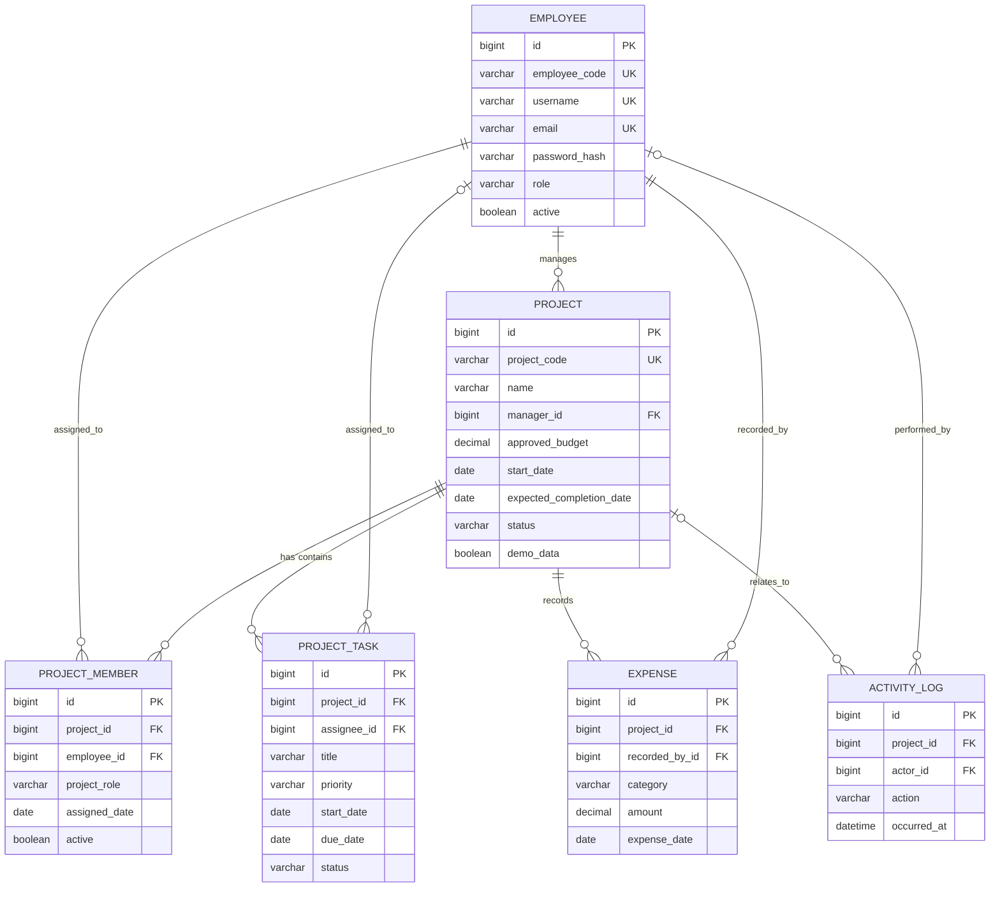

# Project Documentation

## Abstract

The Manik Agro Internal Project Management System (PMS) is a browser-based employee workspace for project overview, progress, budgets, expenditure, tasks, team assignments, and activity history. A Spring Boot REST backend persists records in MySQL and calculates dashboard and financial totals from saved data. A responsive HTML, CSS, and JavaScript client uses session authentication and role-based server authorization.

AJAH is included with the neutral project description provided for this implementation. All its amounts, dates, people, progress, expenses, and tasks are clearly marked as fictional demonstration values. The other two initial projects are explicitly labeled demo projects.

## Introduction

Project records commonly become difficult to coordinate when plans, task ownership, budget tracking, and updates live in separate documents. This application provides a shared internal view of those records and a REST API for maintaining them.

## Problem statement

Employees need a consistent place to review company projects, follow delivery progress, see approved budgets and expenditure, coordinate team members, and find upcoming task deadlines. Summary values must be calculated from persisted records so the dashboard reflects current project data.

## Objectives

- Present project and portfolio information through a readable, responsive interface.
- Persist projects, employees, team assignments, tasks, expenses, and activity in MySQL.
- Calculate spending and remaining budgets on the server from expense records.
- Validate requests and enforce administrator-only mutations on the server.
- Include clearly labeled fictional starter data that authorized users can replace.
- Provide setup, user, API, architecture, and security documentation.

## Project scope

### Included

- Employee login/logout with a server-side session and BCrypt password hashes.
- ADMIN and EMPLOYEE authorization.
- Dashboard statistics, charts, project list and detail, team assignments, tasks, expenses, employee accounts, and activity history.
- Create and update projects, tasks, expenses, and employee records; soft deactivate project members and employee accounts.
- Deletion safeguards for projects that have expense records.
- Jakarta Bean Validation, JSON error responses, Hibernate/JPA persistence, and H2 API integration tests.

### Not included in this version

- External identity provider/SSO, email notifications, file attachments, approval workflows, export/reporting, multi-tenant access, and configurable permission policies.
- Production schema migration tooling and a company-specific backup or disaster-recovery deployment.
- Verification of real company initiative, budget, employee, or operational data.

## Functional requirements

1. An employee can sign in and sign out.
2. An authenticated employee can view dashboard totals, projects, project details, activity history, and upcoming tasks.
3. An administrator can create and update projects and change their status.
4. An administrator can create, update, delete, and assign project tasks.
5. An administrator can record, edit, and delete expenses; totals recalculate from the database after each change.
6. An administrator can assign or deactivate project members and create, edit, or deactivate employees.
7. Duplicate project codes, invalid date ranges, negative budgets, invalid monetary precision, and invalid request fields are rejected.
8. Project deletion is rejected when financial expense history exists. Employee accounts are deactivated rather than physically deleted.
9. Dashboard totals and budget utilization are calculated by backend services, never accepted from the browser.

## Non-functional requirements

- **Security:** hashed passwords, session fixation protection, CSRF tokens, and server-side role checks.
- **Integrity:** foreign keys, unique identifiers, decimal money values, validation, and transactional mutation services.
- **Usability:** responsive layout, keyboard-accessible labels and focus states, loading, empty, and error states.
- **Maintainability:** layered packages, DTO boundaries, enums for statuses, and configuration through environment variables.
- **Performance:** indexes on common status, date, project, and activity lookups. Activity history uses pages capped at 100 rows each.
- **Privacy:** sample employee data is fictional; real employee information must only be added by authorized personnel.

## Software and hardware requirements

### Software

- Java Development Kit 25
- The included Maven Wrapper (downloads Maven 3.9.16 on first use)
- MySQL 8.0+
- A current desktop or mobile browser
- Windows, Linux, or macOS host with network access to the configured database

### Hardware

For local development, a dual-core computer with 4 GB RAM is a practical minimum. Production sizing depends on the number of employees, project/task/expense volume, database retention, backups, and concurrent use; determine it from measured workload.

## System architecture

```mermaid
flowchart LR
    Employee[Employee browser]
    UI[HTML CSS JavaScript frontend]
    Security[Spring Security session and CSRF]
    API[REST controllers and DTO validation]
    Services[Business services and calculations]
    Repositories[Spring Data JPA repositories]
    MySQL[(MySQL database)]
    Employee --> UI
    UI -->|same-origin HTTP and JSON| Security
    Security --> API
    API --> Services
    Services --> Repositories
    Repositories --> MySQL
```

The browser is served from Spring Boot's static resource directory and calls the same-origin API. Controllers bind DTOs and apply request validation. Services enforce date, uniqueness, membership, and deletion rules inside transaction boundaries. Repositories read and write JPA entities. Dashboard summaries use database sums and persisted project/task/member records.

## Module descriptions

| Package or module | Responsibility |
| --- | --- |
| `config` | Session security, CSRF handling, and BCrypt |
| `controller` | Authentication, dashboard, project, task, expense, employee, and activity routes |
| `domain` | Employee, project, project member, task, expense, activity entities, and enums |
| `dto` | Validated API requests and response projections; entities are not returned directly |
| `repository` | Spring Data queries, sums, grouping, and counts |
| `service` | Business validation, transactions, calculations, DTO mapping, and fictional demo initialization |
| `static/assets` | Responsive dashboard, navigation, forms, charts, and API client |
| `exception` | Consistent error envelopes for validation, missing records, conflicts, and bad requests |

## Database design

Monetary values use `DECIMAL(15,2)` and Java `BigDecimal`. Project and task dates use `LocalDate`; activity timestamps use `LocalDateTime`. Enum values are stored as strings. Unique employee code, username, email, and project code constraints prevent duplicate identifiers. Foreign keys link project managers, members, tasks, expense recorders, and activity actors/projects.

Project deletion is restricted by the service when expenses exist. On an allowed project deletion, task and membership rows are removed and historical activity rows are retained without a project link. Employee deactivation preserves foreign-key history. The local schema is initialized through Hibernate `ddl-auto=update`; use versioned schema migrations before a controlled internal deployment.

### Entity relationship diagram

## API documentation

All API routes are under `/api`. Except for CSRF-token retrieval and login, requests need an authenticated session. State-changing browser requests include the CSRF token from `XSRF-TOKEN` in the `X-XSRF-TOKEN` header. JSON validation failures return HTTP 400 with `message` and field-level `details`; uniqueness or relational conflicts return HTTP 409; missing records return HTTP 404.

| Route | Methods | Access | Description |
| --- | --- | --- | --- |
| `/api/auth/csrf` | GET | Public | Establish CSRF cookie/token |
| `/api/auth/login` | POST | Public | URL-encoded `username` and `password` |
| `/api/auth/me` | GET | Signed in | Current employee profile and role |
| `/api/auth/logout` | POST | Signed in | Invalidate session |
| `/api/dashboard` | GET | Signed in | Summary totals, recent activities, deadlines, project views |
| `/api/projects` | GET, POST | GET signed in; POST ADMIN | Search/filter and create projects |
| `/api/projects/{id}` | GET, PUT, DELETE | GET signed in; writes ADMIN | Read detail, edit, or safely delete project |
| `/api/projects/{id}/members` | POST | ADMIN | Assign or reactivate a project member |
| `/api/projects/{id}/members/{employeeId}` | DELETE | ADMIN | Deactivate project assignment |
| `/api/projects/{id}/tasks` | POST | ADMIN | Create task |
| `/api/projects/{id}/tasks/{taskId}` | PUT, DELETE | ADMIN | Update or delete task |
| `/api/projects/{id}/expenses` | GET, POST | GET signed in; POST ADMIN | List or record expenses |
| `/api/projects/{id}/expenses/{expenseId}` | PUT, DELETE | ADMIN | Edit or remove expense |
| `/api/employees` | GET, POST | ADMIN | List or create employee accounts |
| `/api/employees/{id}` | PUT, DELETE | ADMIN | Edit employee or deactivate account |
| `/api/activity` | GET | Signed in | Paged activity; accepts zero-based `page`, `size` (1–100), and optional `projectId` |

The `ProjectRequest` includes project name/code/description, manager ID, approved budget, dates, status, and a demo-data flag. `ExpenseRequest` contains title, category, amount, date, and description. `TaskRequest` contains title, description, optional assignee, priority, dates, and status. Every total shown in the browser comes from persisted records and server-side calculations.

## Security design

- Spring Security uses server-side sessions, HTTP-only session cookies, `SameSite=Lax`, and session fixation protection.
- CSRF protection uses a cookie token and the `X-XSRF-TOKEN` header on mutations.
- Passwords are encoded with BCrypt; password hashes are not included in response DTOs.
- Project-facing responses include employee names, employee codes, roles, and job titles only; login names and email addresses are limited to the employee's own profile and administrator account management.
- `/api/**` requires authentication. Only `ADMIN` can mutate projects, members, tasks, expenses, or employees.
- Login failures do not reveal whether a username exists.
- A local demo administrator can be created or reset by running `database/demo-admin.sql`. It writes a BCrypt hash to the employee table. This shared demo credential is for local databases only and must not be used in a deployment.
- The sample employees have random generated password hashes and no usable published passwords.
- Before deployment, configure HTTPS, a secure database account, environment secret storage, account lifecycle policy, backup/recovery, monitoring, and security review. This repository has not been independently security-certified.

## Testing strategy

`FinancialCalculationsTest` verifies null/zero-budget behavior, utilization precision, and negative remaining budget when spending exceeds the approved amount. `ProjectApiIntegrationTest` runs against an isolated H2 in-memory database in MySQL compatibility mode. It exercises login/session handling, persisted expense aggregation, duplicate project code rejection, and role-based authorization. Run with `mvnw.cmd test` on Windows or `./mvnw test` on macOS/Linux. Before deployment, additionally test against the chosen MySQL version, verify backup/restore, confirm cookie and TLS settings in the deployment environment, and review access using real role assignments.

## Limitations

- Activity history is a compact event description rather than a full immutable audit trail with before/after values.
- The project list and per-project task/expense views currently load all matching records; use paging for large deployments.
- All authenticated employees can view every project in this initial role model.
- The initial JPA schema strategy is for development; a versioned migration process is not configured yet.
- AJAH's seeded values are fictional and do not assert actual company facts.

## Future enhancements

- Add company SSO/MFA and configurable project-level access policies.
- Adopt Flyway/Liquibase migrations, structured audit history, and reviewed retention policies.
- Add pageable project/task/expense APIs, exports, notifications, file attachments, and budget approval workflows.
- Add deployment automation, monitoring, MySQL backup/restore validation, and broader end-to-end browser tests.

## Conclusion

The PMS provides a layered foundation for internal project and financial tracking, with dashboard totals based on database records and server-side controls for account roles and financial operations. Replace every fictional sample value with verified information before employees rely on it.
